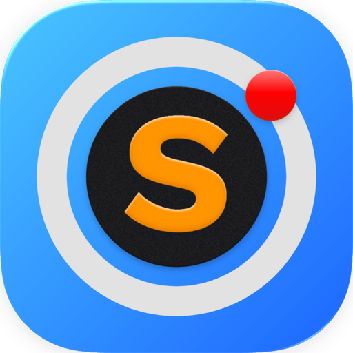

<p align="center">
  
</p>

<h1 align="center">Sentinel Cam</h1>

<p align="center">
  <b>Your cameras, native on your Mac.</b><br>
  A menu bar RTSP viewer with a live popover, all-cameras grid, snapshots,
  and hardware decode — built to feel like macOS.
</p>

<p align="center">
  <a href="https://github.com/charith101/Sentinel-Cam/releases/latest"></a>
  <a href="#requirements"></a>
  <a href="#development"></a>
  <a href="LICENSE"></a>
</p>

---

A native macOS menu bar app for watching RTSP cameras — standalone cameras and
multi-channel NVRs/DVRs alike. Swift 6, SwiftUI + AppKit, hardware H.264/H.265
decode through VideoToolbox. No Xcode required: Command Line Tools and SwiftPM
are enough.

Sentinel Cam is an RTSP viewer, not a camera platform. It does not use ONVIF,
cloud accounts, or vendor apps: if your camera exposes an RTSP URL, it can show
it.

## Features

- **Menu bar preview.** Click the camera icon for a live popover of one camera.
  It closes (and stops decoding) the moment it loses focus, and clicking the
  icon does not steal focus from your current window. `⌥⇧C` toggles it from
  anywhere.
- **Devices and cameras.** A standalone camera is a device with one camera; an
  NVR or DVR is a device with several channels. Add as many devices as you
  like. Credentials and connection settings live on the device; channel,
  quality, and scale live on each camera.
- **Add however you have the details.** Paste an `rtsp://` URL (credentials are
  split out automatically), pick a brand preset, or enter host and path
  manually. Every preset stays editable because firmware paths vary.
- **Test before saving.** The add/edit sheet performs a real RTSP handshake
  (DESCRIBE → SETUP → PLAY) and reports codec, resolution, and audio before
  anything is committed.
- **Main stream by default.** Each camera can opt into its sub stream for lower
  bandwidth. If a device has no sub path, Sub falls back to Main instead of
  failing.
- **All-cameras grid.** 2×2 or 3×3 tiles per page, with pages walked by arrow
  keys. Double-click a tile to maximize it; `Fit` keeps the source aspect ratio,
  `Stretch` fills the box like most CCTV clients.
- **Snapshots.** Save or copy the current frame as PNG from the maximized
  camera (macOS 14.4 or later).
- **Demand-driven decoding.** Only cameras on screen decode. Hide, minimize, or
  cover the window and every stream stops; the app costs essentially nothing
  while idle.
- **Reconnect with backoff.** Streams retry with exponential backoff and jitter,
  and stop after three rejected logins so a camera is not hammered or locked
  out.
- **Portable settings.** Device and camera configuration exports as JSON;
  passwords are deliberately excluded.

## Supported cameras

Brand presets cover the common RTSP families:

| Brand | Typical hardware |
| --- | --- |
| Dahua / Amcrest | Dahua, Amcrest, Lorex, Imou, CP Plus |
| Hikvision / HiLook | Hikvision, HiLook, Annke, EZVIZ |
| Reolink | Reolink cameras and NVRs |
| Tapo / VIGI | TP-Link Tapo and VIGI |
| Axis | Axis cameras |
| Uniview | Uniview / UNV |
| Foscam | Foscam and clones |
| Hanwha / Wisenet | Samsung, Hanwha, Wisenet |
| Vivotek | Vivotek cameras |
| Generic RTSP | Anything with an RTSP URL |

Presets are starting points, not a compatibility guarantee. If a path differs
on your firmware, edit it in **Advanced paths** in the add/edit sheet.

## Requirements

- macOS 14 Sonoma or later (snapshots require macOS 14.4+)
- A camera or recorder that exposes RTSP over the local network
- Video: H.264 or H.265
- Audio: AAC, G.711 A-law/µ-law, or L16. Other audio codecs are ignored; video
  keeps playing.

## Install

### Download

Grab `Sentinel.zip` from the
[latest release](https://github.com/charith101/Sentinel-Cam/releases/latest),
unzip it, and drag **Sentinel.app** into `/Applications`. The build is a
universal binary (Apple silicon + Intel), ad-hoc signed and notarization-free —
see [Gatekeeper](#gatekeeper) for the first-launch prompt.

### Build from source

```zsh
git clone https://github.com/charith101/Sentinel-Cam.git
cd Sentinel-Cam
./Scripts/build-app.sh
open dist/Sentinel.app
```

`build-app.sh` produces a universal (Apple silicon + Intel) bundle at
`dist/Sentinel.app` and ad-hoc signs it. To copy it into `/Applications`:

```zsh
make install
```

### First launch

1. Sentinel Cam is menu-bar only (`LSUIElement`), so there is no Dock icon.
   Click the camera icon in the menu bar.
2. Choose **Add Camera…** and either paste the RTSP URL from the camera's app or
   pick a brand and fill in host, username, and password.
3. Press **Test Connection** to prove the handshake, then **Add**.
4. Open **All Cameras** from the menu bar or press `⌘1`.

macOS asks for **Local Network** permission the first time the app connects.
Allow it in **System Settings → Privacy & Security → Local Network** if you
dismissed the prompt.

### Gatekeeper

Release builds are ad-hoc signed, not notarized. On first launch macOS may say
the app cannot be opened. Either:

- right-click the app in Finder → **Open** → **Open**, or
- remove the quarantine flag:

```zsh
xattr -dr com.apple.quarantine /Applications/Sentinel.app
```

Only do this for a build you trust. Notarization is planned; until then, the
source is the safest way to run it.

## Settings

**Devices** lists every camera and recorder with its address and brand. **Edit…**
changes the connection, credentials, paths, and camera list; **Remove** deletes
the device from Sentinel without touching the camera.

**Cameras** controls the grid density and, per camera:

- name
- recorder channel
- Main or Sub stream
- enabled/disabled

**Menu Bar** chooses which camera the icon previews and how large the popover
is. **General** covers appearance, launch at login, and opening the window at
startup. **Configuration** exports and imports the setup as JSON.

## Security and privacy

- Video goes directly from the camera to this Mac. There is no cloud service,
  telemetry, or account.
- Passwords live in
  `~/Library/Application Support/Sentinel/secrets.json` with `0600`
  permissions, readable only by your user. They are **not** stored in the
  Keychain: ad-hoc signed builds change identity on every rebuild, which makes
  macOS re-prompt for the login keychain each time. If you sign with a real
  Developer ID, moving back to Keychain is a small change.
- Exported configuration never contains passwords.
- Credentials pasted inside an RTSP URL are split into host/username/password
  fields; the URL itself is not stored.
- RTSP authentication supports Basic and Digest (MD5 and SHA-256) through
  IPCamKit.
- RTSP is unencrypted. `rtsps://` (TLS) is not supported by the current
  IPCamKit dependency. Use cameras on a trusted network or a VPN.

## Limitations

- No ONVIF discovery, PTZ, recording, or motion events. Sentinel Cam is a live
  viewer.
- No `rtsps://` / RTSP-over-TLS.
- Brand presets cannot cover every firmware variant; paths may need editing.
- Audio support depends on the codec the camera advertises.
- Snapshots need macOS 14.4+ because they use
  `AVSampleBufferDisplayLayer.sampleBufferRenderer`.
- The app is menu-bar first. Closing the main window hides it; streams stop
  until it is shown again.

## Migrating from the single-recorder version

Existing `config.json` files from the original single-DVR build migrate
automatically on first launch:

- the recorder becomes one device, and its channels become cameras
- channel names, enabled flags, grid density, menu bar size, and appearance are
  preserved
- the old menu channel becomes the menu bar camera
- the old `password` file is read once into `secrets.json`
- migrated cameras use the Main stream and Stretch, matching the previous
  picture

The original file is kept next to the new one as
`config.v1.backup.json`. Nothing is deleted.

## Configuration files

| Path | Contents |
| --- | --- |
| `~/Library/Application Support/Sentinel/config.json` | Devices, cameras, UI settings (no passwords) |
| `~/Library/Application Support/Sentinel/secrets.json` | Device passwords, mode `0600` |
| `~/Library/Application Support/Sentinel/config.v1.backup.json` | Pre-migration config, if migration ran |

## Development

```zsh
swift build                 # debug build
swift run Sentinel --selftest
./Scripts/build-app.sh      # universal release bundle + ad-hoc signature
make install                # copy the bundle to /Applications and launch
```

The self-test covers URL building, brand presets, pasted-URL parsing, IPv6,
legacy migration, config round-tripping, duplicate-ID repair, and empty-device
handling. It needs no camera.

### Architecture

- `IPCamKit` — RTSP/RTP and Digest authentication (pinned `0.3.2`).
- `CameraStream` — one RTSP session per feed, reconnect loop, and a renderer
  that repackages NALUs into `CMSampleBuffer`s for VideoToolbox.
- `CameraFeed` — `@Observable @MainActor` state per camera
  (idle / connecting / live / failed), audio gating, snapshots.
- `GridModel` — owns feeds and starts exactly the cameras on screen.
- `ConfigStore` / `AppConfig` — v2 device→camera model, tolerant decoding,
  migration, and debounced persistence.
- UI: AppKit lifecycle (`NSStatusItem` + `NSPopover`) with SwiftUI views.

## License

MIT. See [LICENSE](LICENSE) and [ACKNOWLEDGEMENTS.md](ACKNOWLEDGEMENTS.md).
